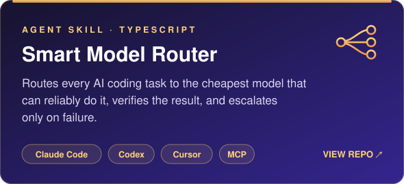
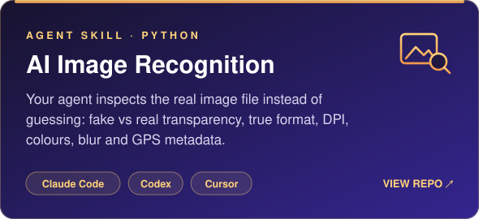

  

  
  
  
  
  
  

<h2 align="center">Hi, I'm Smiling Buddha 🙏</h2>

  Solo builder from India and founder of <a href="https://desitechnology.com/">DESITechnology</a>. 
  I find small, annoying problems and turn them into free tools anyone can use. 
  I build with AI coding agents and say so openly: the ideas, testing and upkeep are mine.

## 🪷 Selected work

  
  

  
  
  &nbsp;&nbsp;
  
  
  

## 🧭 How I build

  

## 🇮🇳 The DESITechnology family

Bharat-first platforms. Built with care, never sold out.

| Platform | What it is |
| --- | --- |
| [**DesiSurveys**](https://desisurveys.com/) | A directory of genuine paid-survey platforms open to Indians. |
| [**DesiAffiliates**](https://desiaffiliates.com/) | Trusted affiliate and referral programmes for Indians. |
| [**DesiTasks**](https://desitasks.com/) | Microtask and freelancing platforms that work for Indians. |
| [**DesiEditor**](https://desieditor.in/) | A free, privacy-focused online file editing tool. |
| [**DesiWish**](https://desiwish.in/) | Personal greetings for Indian occasions, ready to share on WhatsApp. |
| [**More platforms**](https://desitechnology.com/platforms.html) | Money calculators, an Indian calendar and more. |

## 🌱 What I stand for

| | |
| --- | --- |
| **Non-harm** | No gambling, betting, lucky draws or addictive design. |
| **Dignity for all** | Equal respect for users, sellers and partners. |
| **No irritation** | No pop-ups, fewer ads, no spam alerts. |
| **Self-reliance** | Indian technology, built and owned in India. |
| **Long-term well-being** | Lasting trust over quick profit. |
| **Open source** | My agent skills are MIT-licensed and will stay free. |

## 🤝 Contributions welcome

Both skills have issues labelled **good first issue**. Pick one, comment on it, and I'll assign it to you.

  
  

## 🛠 Tools I work with

  
  
  
  
  
  
  

  

